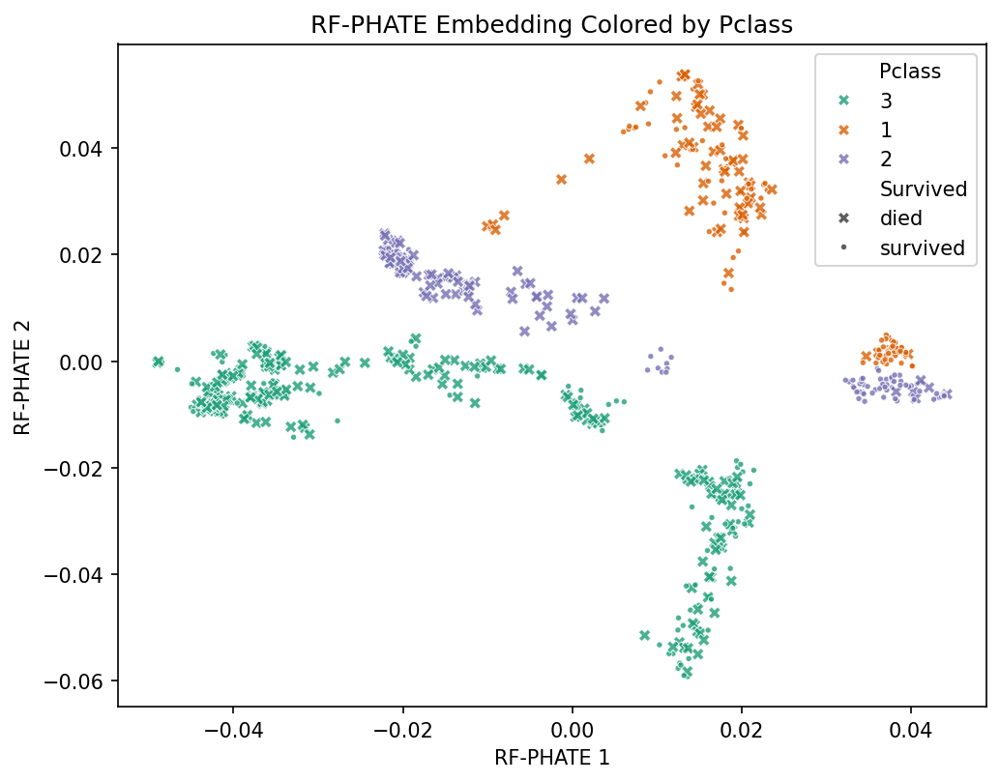
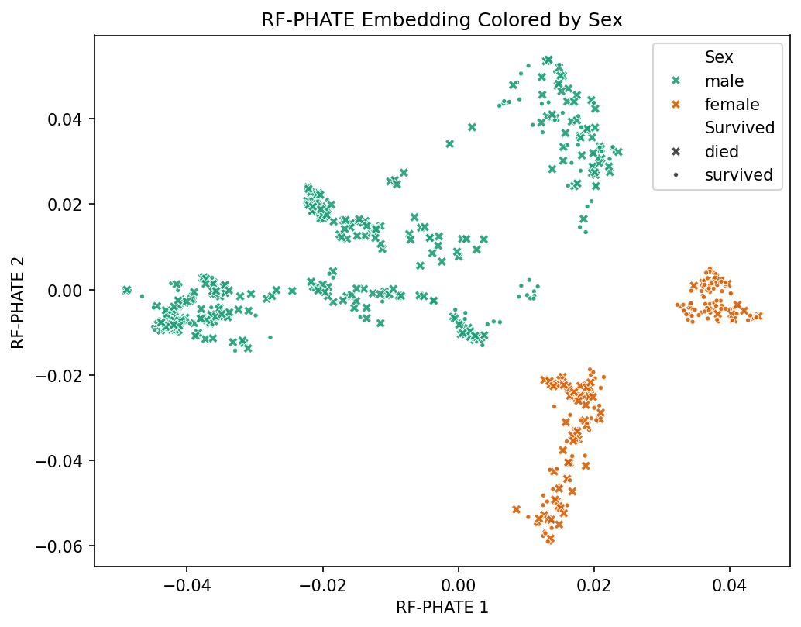

# RF-PHATE

RF-PHATE creates supervised, low-dimensional embeddings from forest proximity
matrices and a PageRank PHATE operator. It is designed for exploratory data
analysis when the target variable should guide the geometry of the embedding.

The current implementation builds proximities with
[`forestgeom`](https://github.com/JakeSRhodesLab/forestgeom) `Proximity`
objects, using scikit-learn forest estimators under the hood.

A repository with scripts to replicate the main quantification comparisons from
the paper is available at
[RF-PHATE-Quantification](https://github.com/jakerhodes/RF-PHATE-Quantification).

## Installation

RF-PHATE supports Python 3.10–3.14. Install
[`uv`](https://docs.astral.sh/uv/getting-started/installation/) 0.11.16 or newer,
then create a development environment from the committed lockfile:

```bash
git clone https://github.com/jakerhodes/RF-PHATE.git
cd RF-PHATE
uv sync --locked
uv run --locked pytest -q
```

uv uses Python 3.12 by default, as selected in `.python-version`, and creates
an editable installation in `.venv`. The `dev` dependency group supplies pytest
and coverage tools. To install only runtime dependencies, use
`uv sync --locked --no-dev`.

For the examples and notebook, enable the demo extra and select `.venv` as the
Python environment in your notebook editor:

```bash
uv sync --locked --extra demo
uv run --locked --extra demo python -m ipykernel install --user --name rfphate
```

The demo extra includes Matplotlib, seaborn, Plotly, nbformat, and ipykernel.
Core dependencies include `forestgeom>=0.4.0,<0.5`, `graphtools`, `phate`,
`scikit-learn`, `numpy`, `scipy`, `pandas`, and `joblib`.

To install RF-PHATE into another uv project, use
`uv add "rfphate @ git+https://github.com/jakerhodes/RF-PHATE.git"`.
Standard pip installation from the same Git URL is also supported; consumers
resolve the package's dependency ranges rather than using this repository's
development lockfile.

## Development and Validation

`pyproject.toml` declares dependencies and `uv.lock` records their resolved
versions. Commit both when dependencies change. Add dependencies with `uv add`,
development tools with `uv add --dev`, and demo packages with
`uv add --optional demo`. CI uses uv 0.11.16 and checks the lockfile before testing.

```bash
uv lock --check
uv sync --locked
uv run --locked pytest -q --cov=rfphate --cov-report=term-missing
uv build --no-sources
```

To deliberately update forestgeom within the supported 0.4 series, run
`uv lock --upgrade-package forestgeom`, run the complete test suite, and commit
the reviewed lockfile change. A move to 0.5 or later requires updating the
declared range and reviewing the integration tests. Avoid local forestgeom
paths or floating Git branches in committed configuration.

For tools requiring a requirements file, generate one from the lockfile:

```bash
uv export --locked --no-dev --no-emit-project --format requirements-txt --output-file requirements.txt
```

The exported file describes runtime dependencies; install RF-PHATE separately
from its wheel or source. It is generated output and is not maintained by hand.
CI also builds a wheel from the source distribution, installs it in a fresh
runtime-only environment, and checks datasets and the original integration suite
from outside the checkout.

## Datasets

`rfphate.load_data()` returns the Iris data. The other bundled CSV
names are `"titanic"`, `"auto-mpg"`, and `"artificial_tree"`. Each result is a
pandas DataFrame with the target in its first column, ready for
`rfphate.dataprep(data)`.

OpenML datasets use the same interface. The named examples `"credit-g"` and
`"wine-quality-red"` refer to fixed OpenML dataset IDs and the `class` target.
Any positive OpenML dataset ID can also be supplied directly. For an ID,
`target` selects a column; without it, the dataset's OpenML default target is
used. Each call returns a single target followed by the feature columns.

```python
import rfphate

data = rfphate.load_data("credit-g")
same_dataset = rfphate.load_data(31, target="class")
x, y = rfphate.dataprep(data)

# An OpenML ID outside the named examples also works:
other_data = rfphate.load_data(40691)
```

The first OpenML load needs internet access; scikit-learn caches downloads
under its default data directory (`~/scikit_learn_data`) for later use. The
dataset files are not included in the RF-PHATE wheel. When an OpenML dataset
has no default target or has multiple targets, pass one target column by name.
The loader preserves the dataset's original values and dtypes; handle missing
values and other preprocessing according to your analysis.

OpenML sources: [`credit-g`, ID 31](https://www.openml.org/search?id=31&type=data)
and [`wine-quality-red`, ID 40691](https://www.openml.org/search?id=40691&type=data).

## Forestgeom Refactor

RF-PHATE now delegates random forest proximity construction to
`forestgeom.Proximity`. The `RFPHATE` class wraps a supplied ensemble in
`Proximity` and passes the resulting proximity matrix to `PageRankPHATE`.

Important API points:

- `forest` accepts an estimator instance supported by forestgeom, including
  classifiers, regressors, and compatible ensemble adapters. When omitted or
  set to `None`, it uses `RandomForestClassifier()` with scikit-learn defaults.
  Configure forest settings directly on the estimator. Forestgeom clones and
  fits unfitted estimators and reuses fitted estimators.
- `random_state` and `n_jobs` configure `PageRankPHATE`. Configure the forest's
  random seed and parallelism on the supplied estimator.
- `proximity_params` are passed to `forestgeom.Proximity`.
  The supported option is `weight_scheme`: `"uniform"`, `"oob"`, `"gap"`
  (the RF-PHATE default), `"kerf"`, or `"boosted"`. Forestgeom 0.4 returns
  sparse matrices by default and no longer accepts `matrix_type`.
- `phate_params` are passed to `PageRankPHATE`.
  Typical keys include `n_components`, `t`, `n_landmark`, `verbose`,
  `mds_solver`, and `beta`.
- RF-PHATE always enforces `phate_params["knn_dist"] = "precomputed_affinity"`.
- `force_symmetric` and `adjust_diagonal` are training-kernel options passed
  to `fit` or `fit_transform`.
- GAP is directional by default. With `force_symmetric=False`, graphtools may
  emit `K should be symmetric`; use `force_symmetric=True` when a symmetric
  training kernel is desired.
- `transform(data)` embeds new observations using the fitted forest proximity
  model and PHATE graph interpolation.
- Sparse feature inputs are converted to dense arrays at the forestgeom 0.4
  boundary. The forest proximity and extension matrices remain sparse.

## Quick Demo

```python
from pathlib import Path

import matplotlib.pyplot as plt
import seaborn as sns
import rfphate
from sklearn.ensemble import RandomForestClassifier

Path("figures").mkdir(exist_ok=True)

data = rfphate.load_data("titanic")
x, y = rfphate.dataprep(data)

rfphate_op = rfphate.RFPHATE(
    random_state=42,
    n_jobs=-1,
    forest=RandomForestClassifier(
        n_estimators=100, random_state=42, n_jobs=-1, verbose=1,
    ),
    proximity_params={
        "weight_scheme": "gap",
    },
    phate_params={
        "verbose": 1,
        "mds_solver": "sgd",
    },
)

emb = rfphate_op.fit_transform(
    x,
    y,
    force_symmetric=True,
    adjust_diagonal=True,
)

plot_data = data.assign(
    **{
        "RF-PHATE 1": emb[:, 0],
        "RF-PHATE 2": emb[:, 1],
        "Pclass": data["Pclass"].astype(str),
    }
)
```

Color the embedding by passenger class and use marker style for survival. The
saved PNG uses the same `plot_data` coordinates built from `emb` above:

```python
plt.figure(figsize=(7, 5.5), dpi=150)
plot = sns.scatterplot(
    data=plot_data,
    x="RF-PHATE 1",
    y="RF-PHATE 2",
    hue="Pclass",
    style="Survived",
    markers={"survived": ".", "died": "X"},
    alpha=0.8,
    palette="Dark2",
)
plot.set_title("RF-PHATE Embedding Colored by Pclass")
plot.set_xlabel("RF-PHATE 1")
plot.set_ylabel("RF-PHATE 2")
plt.savefig("figures/titanic_pclass.png", bbox_inches="tight")
plt.show()
```



Color the same embedding by passenger sex. The saved PNG uses the same
`plot_data` coordinates built from `emb` above:

```python
plt.figure(figsize=(7, 5.5), dpi=150)
plot = sns.scatterplot(
    data=plot_data,
    x="RF-PHATE 1",
    y="RF-PHATE 2",
    hue="Sex",
    style="Survived",
    markers={"survived": ".", "died": "X"},
    alpha=0.9,
    palette="Dark2",
)
plot.set_title("RF-PHATE Embedding Colored by Sex")
plot.set_xlabel("RF-PHATE 1")
plot.set_ylabel("RF-PHATE 2")
plt.savefig("figures/titanic_sex.png", bbox_inches="tight")
plt.show()
```



## Train/Test Embedding

Fit RF-PHATE on training data, then embed held-out observations with
`transform`:

```python
from sklearn.model_selection import train_test_split

x_train, x_test, y_train, y_test = train_test_split(
    x, y, test_size=0.25, random_state=42, stratify=y
)

rfphate_split_op = rfphate.RFPHATE(
    forest=RandomForestClassifier(random_state=42, n_jobs=-1),
    random_state=42,
    n_jobs=-1,
    proximity_params={
        "weight_scheme": "gap",
    },
)

emb_train = rfphate_split_op.fit_transform(
    x_train,
    y_train,
    force_symmetric=True,
    adjust_diagonal=True,
)
emb_test = rfphate_split_op.transform(x_test)
```

## Citation

If you find RF-PHATE useful, please cite:

Rhodes, J.S., Aumon, A., Morin, S., et al. Gaining Biological Insights through
Supervised Data Visualization. Nature Computational Science (2026).
https://doi.org/10.1038/s43588-026-00999-7.
